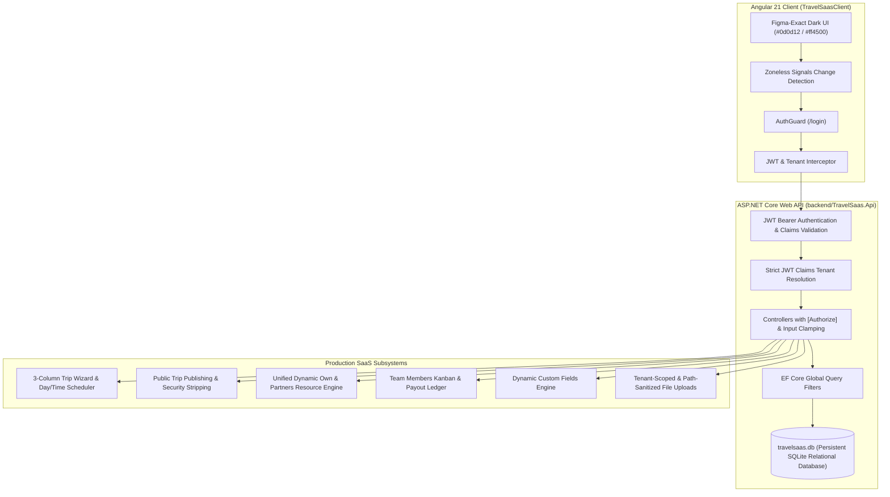

# TravelSaas — Production SaaS Platform (V4Journey)

> **"V4Journey — Every mile brings a smile!"**  
> A real, fully functional, persistent, and secure multi-tenant commercial SaaS product for travel and tour operators, built with an **ASP.NET Core Web API (.NET 10.0)** backend and an **Angular 21** standalone frontend.

---

## 1. Production Architecture



---

## 2. Production Security & Architecture Hardening

Following a comprehensive production readiness audit, the platform has been hardened with the following enterprise safeguards:

1. **Persistent Relational Database**:
   - Replaced ephemeral In-Memory storage with **SQLite relational database (`travelsaas.db`)**.
   - All data (trips, bookings, members, payments, audit logs, custom fields) **persists permanently across server restarts and crashes**.
   - Database schema uses real constraints, unique indexes (`{TenantId, TripCode}`), and relational foreign keys.

2. **Strict Multi-Tenant Isolation**:
   - Resolved `TenantId` **strictly from cryptographically validated JWT claims** (`User.FindFirst("TenantId")`).
   - Tenant header spoofing is blocked; regular authenticated users can never access or query other tenants' data. Cross-tenant access is restricted to authenticated `SuperAdmin` roles.

3. **Authentication & Authorization Pipeline**:
   - Activated ASP.NET Core `JwtBearer` authentication and authorization middleware in `Program.cs`.
   - Decorated all operational controllers with `[Authorize]`, restricting anonymous access to `/health`, `/api/auth/login`, and `/api/public/**`.
   - Upgraded password hashing from static SHA-256 to **PBKDF2 with HMAC-SHA256, 16-byte random salts, and 100,000 iterations**.

4. **Angular 21 Zoneless Change Detection**:
   - Resolved runtime boot error `NG0908` by configuring `provideZonelessChangeDetection()` in `app.config.ts`, aligning with modern signal-driven Angular 21 architecture without Zone.js overhead.
   - Built a dedicated dark Figma-styled `LoginComponent` with `AuthGuard` protection on all internal routes.

5. **Input Clamping & File Upload Sanitization**:
   - Added upper bound clamping on server-side pagination (`pageSize = Math.Clamp(pageSize, 1, 100); page = Math.Max(1, page)`).
   - Sanitized upload subfolder parameters (`Regex.Replace(subFolder, @"[^a-zA-Z0-9_-]", "")`) to prevent directory traversal attacks, and partitioned files on disk by `tenantId`.

---

## 3. Quick Start & Execution

### Running the Backend API (.NET 10.0)
```powershell
cd C:\Source\apps\TravelSaas\backend\TravelSaas.Api

# Launch the production binary:
dotnet bin/Debug/net10.0/TravelSaas.Api.dll --urls "http://127.0.0.1:5000"
```
- **Base URL**: `http://127.0.0.1:5000`
- **Health Check**: `http://127.0.0.1:5000/health`
- **Database**: `travelsaas.db` (Persistent SQLite)

### Running the Angular Client (Angular 21)
```powershell
cd C:\Source\apps\TravelSaas

# Serve the prebuilt production bundle:
node serve-spa.js
```
- **Client URL**: `http://127.0.0.1:4200`
- **Login Route**: `http://127.0.0.1:4200/login`

---

## 4. Default Credentials & Multi-Tenancy

| Tenant Name | Slug | User Email | Password | Role | Context |
|---|---|---|---|---|---|
| **V4Journey Fleet** | `v4journey` | `admin@v4journey.com` | `Admin@123` | `Owner / Director` | Primary tenant with 4 trips (`#0001`–`#0004`), 4 fleets/hotels, team members, payout ledger, and audit logs. |
| **SkyWay Holidays** | `skyway` | `operator@skyway.com` | `SkyWay@123` | `Owner` | Isolated second tenant with 1 private trip (`#SKY-01`). Verified strict isolation. |

*Note: The login page includes one-click quick demo buttons for both accounts.*

---

## 5. Automated Verification & In-Browser Test Suites

### Suite A: Backend API Verification (13/13 Checks Passed)
```powershell
powershell -ExecutionPolicy Bypass -File C:\Source\apps\TravelSaas\run-verification.ps1
```
- `[1/13]` **Health Check** (`GET /health`) → `200 OK` (Healthy, SQLite Persistent)
- `[2/13]` **JWT Authentication** (`POST /api/auth/login`) → `200 OK` (Bearer token issued for Director)
- `[3/13]` **Dashboard Stats** (`GET /api/dashboard/stats`) → `200 OK` (Real database stats)
- `[4/13]` **Trips Listing & Filters** (`GET /api/trips?page=1&pageSize=10`) → `200 OK` (Paginated trip list)
- `[5/13]` **Create Trip Wizard** (`POST /api/trips`) → `201 Created` (Saved with 3 itinerary schedules)
- `[6/13]` **Trip Details & Schedules** (`GET /api/trips/{id}`) → `200 OK` (Day 1 & Day 2 itinerary schedules)
- `[7/13]` **Publishing Engine** (`POST /api/trips/{id}/publish`) → `200 OK` (Generated public slug)
- `[8/13]` **Public Page Security** (`GET /api/public/trips/{slug}`) → `200 OK` (Internal margins & spends stripped)
- `[9/13]` **Dynamic Resource Types** (`GET /api/resources/types`) → `200 OK` (Vehicle, Hotel, Restaurant, Lodge schemas)
- `[10/13]` **Dynamic Resource Creation** (`POST /api/resources`) → `201 Created` (Vehicle #0049 with custom properties)
- `[11/13]` **Team Members & Payout Ledger** (`GET /api/members` & `POST /api/payments`) → `200 OK` (Disbursement with receipt number)
- `[12/13]` **Custom Fields Engine** (`POST /api/custom-fields`) → `200 OK` (Dynamic attribute registered for Member)
- `[13/13]` **Strict Multi-Tenant Isolation** (`GET /api/trips` & `GET /api/trips/{id}`) → `200 OK` (Tenant 2 isolated, cross-tenant lookups blocked with 404)

### Suite B: In-Browser Headless Chrome Audit (8/8 Checks Passed)
```powershell
node frontend-audit.js
```
- `[1/8]` **AuthGuard & Login Flow** → Redirected to `/login`, authenticated via API, redirected to `/dashboard`
- `[2/8]` **Dashboard KPIs & Live Audit Stream** → Rendered real database KPIs and event logs
- `[3/8]` **Trips List & Table Operations** → Loaded trip rows, applied search filter for "Munnar", verified pagination
- `[4/8]` **Trip Details & Action Modals** → Verified journey progress, opened and closed Share / Publish modal
- `[5/8]` **3-Column Create Trip Wizard** → Rendered 3-column Figma wizard layout
- `[6/8]` **Unified Own & Partners Hub** → Switched dynamic resource types (Vehicle → Hotel), opened slide-out drawer
- `[7/8]` **Team Members & Payout Ledger** → Switched Kanban board to Table view, opened Member Details with contract badge
- `[8/8]` **Navigation Persistence & Settings** → Verified dynamic custom fields, refreshed on `/trips` with 0 console errors and 0 network failures
